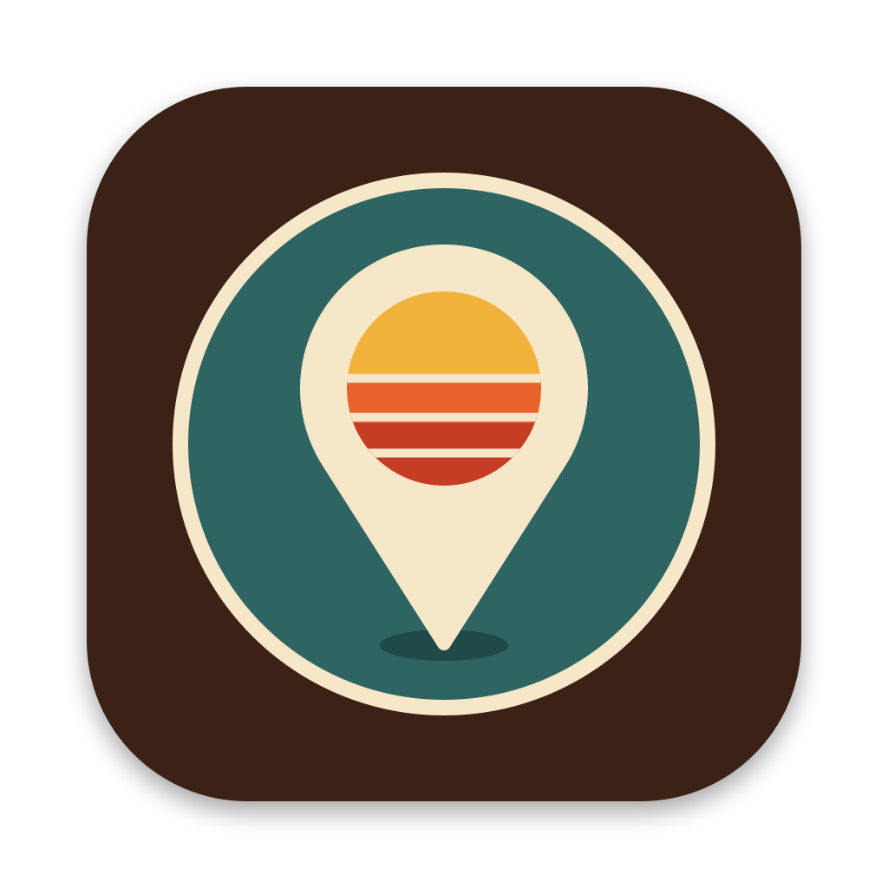
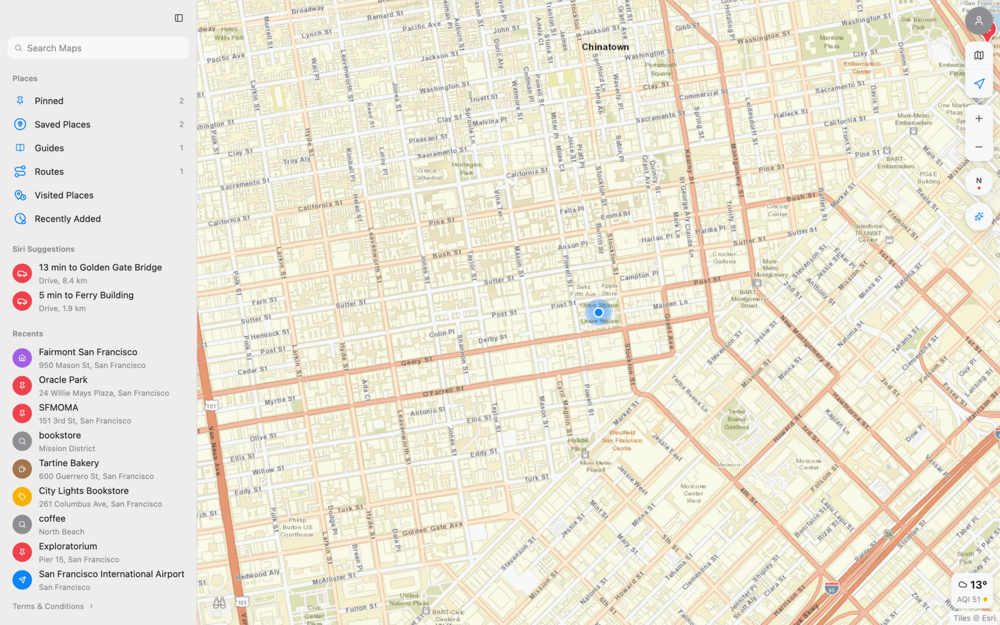
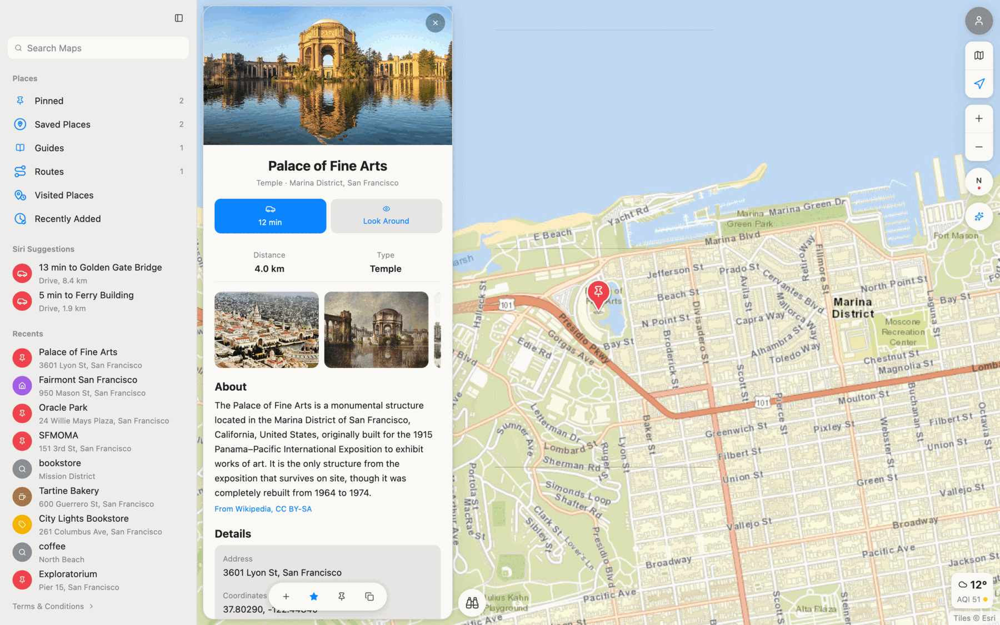
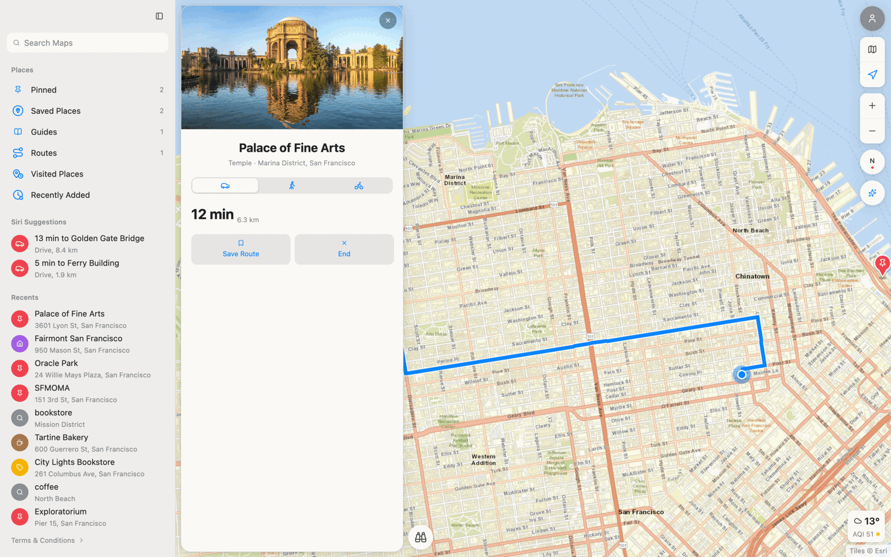
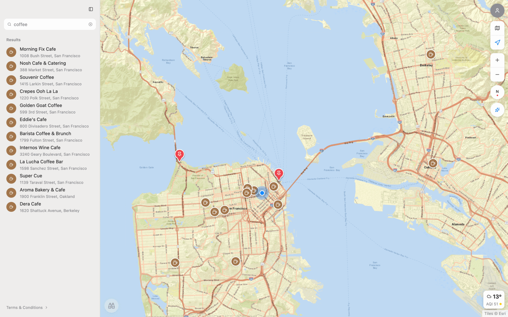
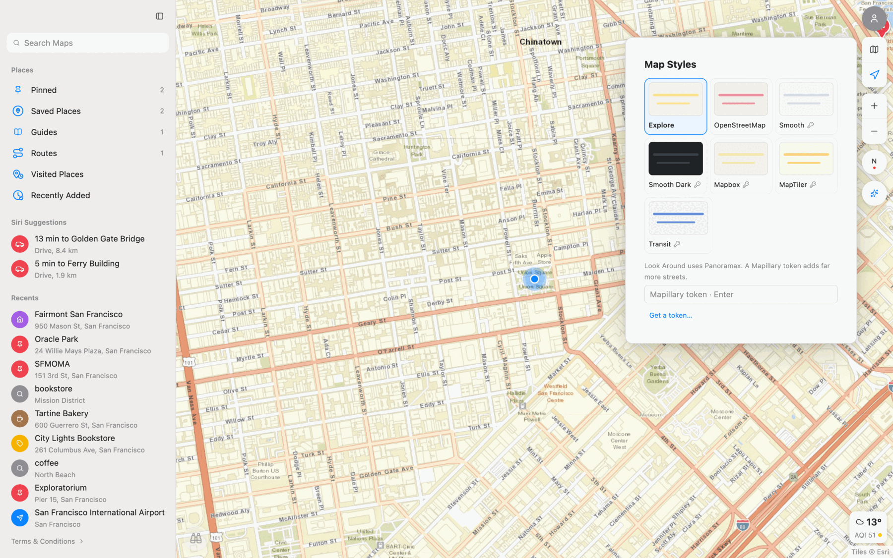
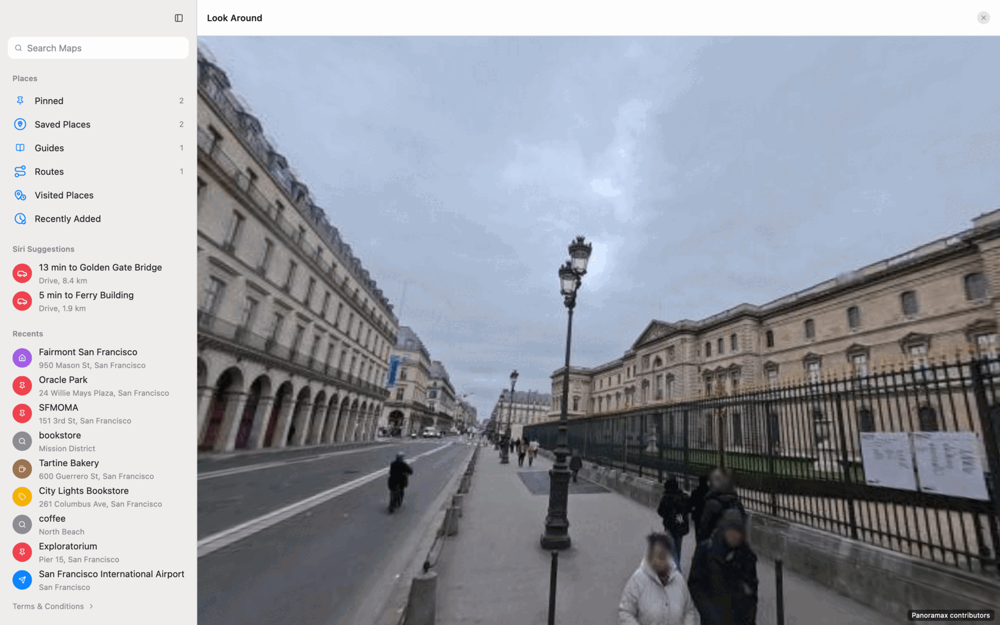
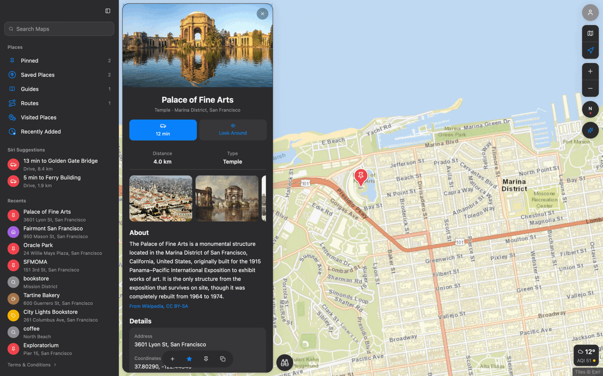

<p align="center">
  
</p>

<h1 align="center">Moonmap</h1>

<p align="center">
  A desktop map app laid out like Apple Maps.<br>
  Pick your tiles, and reshape it while it runs.
</p>

<p align="center">
  <a href="#install"><b>Install</b></a> ·
  <a href="#gallery">Gallery</a> ·
  <a href="#what-it-does">What it does</a> ·
  <a href="#place-sheet">Place sheet</a> ·
  <a href="#make-it-yours">Make it yours</a> ·
  <a href="#limitations">Limitations</a>
</p>

Moonmap is a desktop map app on [Moonframe](https://moonframe.dev): a sidebar
of places and recents, Maps' control stack down the map's right edge, Look
Around bottom-left and the weather bottom-right. The map is Moonframe's
`ui.map`, and the tiles come from whichever provider you pick. It is not
affiliated with Apple.

## Gallery

<p align="center">
  
  <br>
  <sub><b>The window.</b> Places, suggestions and recents on the left; the map's controls on the right.</sub>
</p>

<table>
  <tr>
    <td width="50%" valign="top">
      
      <br>
      <sub><b>Place sheet.</b> Photos and a description from Wikipedia, details from OpenStreetMap.</sub>
    </td>
    <td width="50%" valign="top">
      
      <br>
      <sub><b>Directions.</b> By car, on foot or by bike, routed along the streets.</sub>
    </td>
  </tr>
  <tr>
    <td width="50%" valign="top">
      
      <br>
      <sub><b>Search.</b> Nearest first, in the sidebar and on the map.</sub>
    </td>
    <td width="50%" valign="top">
      
      <br>
      <sub><b>Map Styles.</b> Switch tile providers; some take an API key.</sub>
    </td>
  </tr>
  <tr>
    <td width="50%" valign="top">
      
      <br>
      <sub><b>Look Around.</b> 360° panoramas you drag, zoom and walk through, here from Panoramax.</sub>
    </td>
    <td width="50%" valign="top">
      
      <br>
      <sub><b>Light and dark.</b> The window follows the system.</sub>
    </td>
  </tr>
</table>

## Install

Moonmap has no release yet, so build it from source. You need
[rustup](https://rustup.rs), Xcode Command Line Tools and
[Just](https://just.systems). The first build compiles Moonframe and GPUI and
can take several minutes.

```sh
just demo        # a fixed position at Union Square and public San Francisco places
just run         # your own library: ~/Library/Application Support/moonmap, or %APPDATA%\moonmap on Windows
just app         # a standalone release bundle in target/bundle
just screenshot target/screenshots/home.png home   # home, place, directions, styles, results, dark
just screenshots # retake the screenshots above
just ci
```

`just demo` never asks the location service, and it rebuilds its library on
each launch.

## What it does

- **My Location**: CoreLocation at its best accuracy, with no distance
  filter. If you granted only an approximate location, it asks once for
  full accuracy. The blue dot breathes while the fix is live and turns grey
  when it only shows where you were last seen. Hover the location button
  to see the accuracy.

- **Search**: Nominatim (OpenStreetMap). It looks near the map first, nearest
  first, then tries a category word ("coffee" becomes cafe), then searches
  anywhere.
- **Places**: Pinned, Saved Places, Guides (your own collections), Routes,
  Visited Places (places you opened) and Recently Added, kept in
  `library.json`.
- **Siri Suggestions**: drive times from My Location to your first two pinned
  places, from OSRM at routing.openstreetmap.de.
- **Directions**: car, walk or bike, routed along streets by `ui.map`. You
  can save a route.
- **Map Styles**: the map button switches tile providers. Styles that need
  an API key take one in the picker. It is stored in the library file, in
  plain text.
- **Weather**: Open-Meteo temperature and US AQI at the map's center.

## Place sheet

Opening a place shows a full-height sheet. Its website, phone, hours, kind and
area come from OpenStreetMap, and its description and photos from Wikipedia,
when the place has a page. No open source gives ratings or booking offers, so
the sheet has neither. Sections with nothing to show are left out.

## Make it yours

The sparkles under the map controls open a dialog: say what should change,
optionally pick an element with Inspect, and a coding agent (Claude by default)
changes the app's files. It asks before each change, and the window reloads
with the result. Replies go under **Feedback & fixes**. It needs an agent with
an ACP mode, or Node for `npx`.

## Limitations

- Sparkles in a packaged app: outside a repository the agent works in
  `~/.config/moonframe`, while Moonmap reads `~/.config/moonmap`. Use a debug
  build from this repository until `cwd` in `providers/acp` covers it.
- macOS gives a location only to an app bundle. `just run` and `just demo`
  run the debug build from `target/dev/Moonmap.app`. A bare `cargo run`
  shows a notice instead, and so does a terminal launch on first use: there
  the terminal, not Moonmap, gets the permission request. Launch with
  `open target/dev/Moonmap.app` the first time so macOS asks Moonmap.
  `MOONMAP_DEBUG_LOCATION=1` prints what CoreLocation reports.
- A Mac locates itself by Wi-Fi, usually to within 20 to 60 m. Maps.app
  reads the same service, so it isn't more precise; it may only have had
  a fix longer.
- The tiles are raster and `ui.map` draws them flat, so there is no 3D. Their
  labels are part of the image, so they shrink between zoom levels.
- The **compass** button is not connected yet: it always shows north, and
  clicking it does not turn the map back.
- **Look Around** shows 360° panoramas from Panoramax, or from Mapillary with
  a token set in Map Styles. Panoramax has little outside France, so without
  a token many places show the button disabled: it needs a panorama within
  150 m.
- CARTO's basemaps now return an "API key required" tile to every keyless
  request. Moonframe's `carto-*` providers have no key slot, so Moonmap
  leaves them out until Moonframe adds one.
- Apple's points of interest come from Apple's vector data. Here, what you
  see is whatever the chosen tile style draws.
- `just run` and `just demo` work on macOS, Windows, and Linux under Wayland
  or X11. On Linux they find the session's display when the terminal has
  none. My Location is macOS only, and the Windows build has not been tested.

## License

MIT. Map data, tiles, photos and panoramas belong to their providers and
contributors, as credited in the app.
